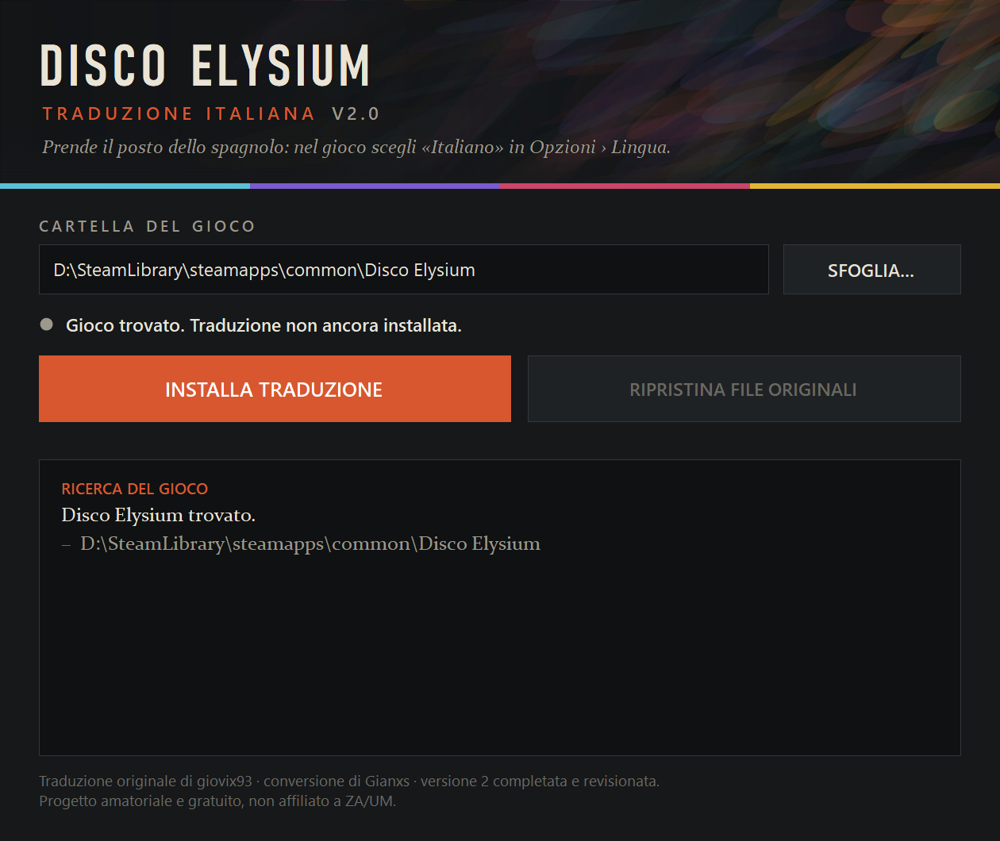
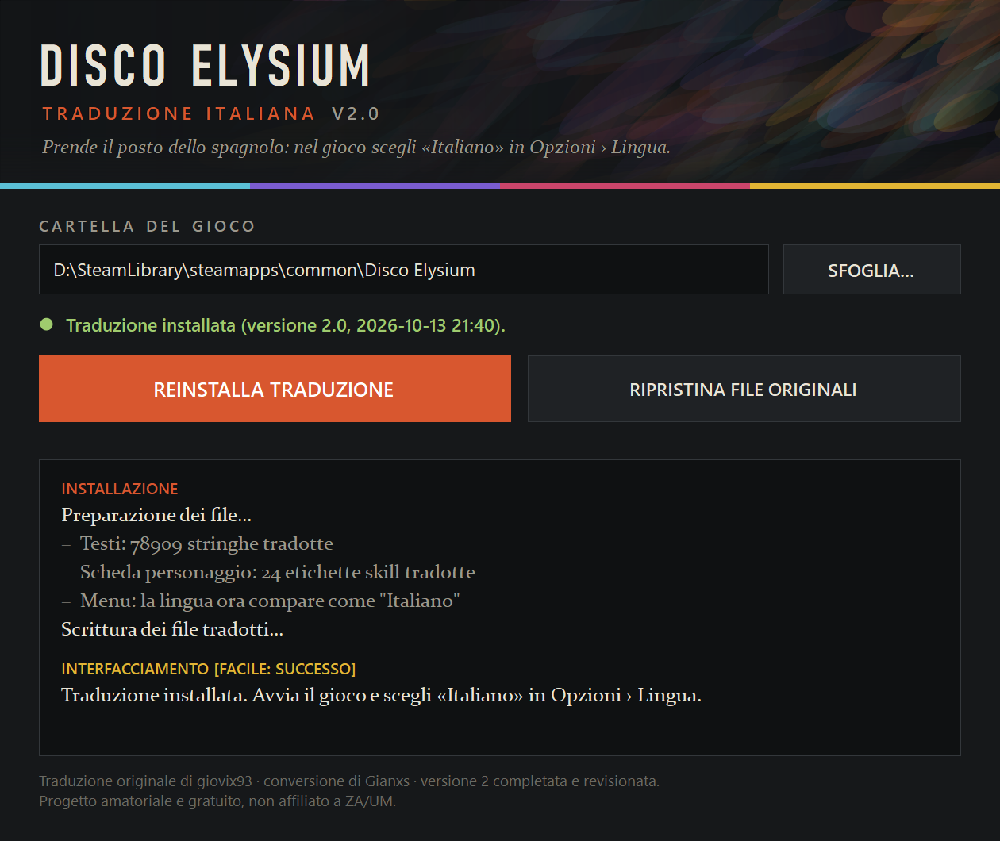

# Disco Elysium – The Final Cut · Traduzione italiana 2.0

Traduzione italiana completa di **Disco Elysium – The Final Cut** (Windows), con installatore automatico
che trova il gioco, salva i file originali e permette di ripristinarli in qualsiasi momento.

È il completamento e la revisione della traduzione di **giovix93**, convertita da **Gianxs**
([Nexus Mods #26](https://www.nexusmods.com/discoelysium/mods/26)).
Non serve BepInEx.

<p align="center">
  
  
</p>

## Download

Scarica l'archivio `DiscoElysium_Traduzione_ITA_v2.0_cmd.zip` dalla pagina
**[Releases](../../releases/latest)**.

L'archivio non contiene programmi già compilati: `Installa.cmd` compila sul momento il codice C# della
cartella `sorgenti` con il compilatore incluso in Windows e apre la finestra di installazione.
Chiunque può quindi leggere cosa fa il programma prima di avviarlo.

## Installazione

1. Estrai **tutto** l'archivio in una cartella qualsiasi.
2. Chiudi il gioco.
3. Fai doppio clic su **`Installa.cmd`**. Si apre per qualche secondo una finestra nera, poi quella del programma.
4. Il programma trova da solo la cartella del gioco (Steam, GOG, Epic). Se non la trova, premi
   *Sfoglia…* e indica la cartella che contiene `disco.exe`.
5. Premi **Installa traduzione**.
6. Nel gioco: *Opzioni → Lingua →* **Italiano** (prende il posto di *Español*).

> Se Windows chiede conferma prima di aprire `Installa.cmd`, scegli *Apri* (oppure *Ulteriori informazioni →
> Esegui comunque*). Se non è possibile scrivere nella cartella del gioco, clic destro su `Installa.cmd` →
> *Esegui come amministratore*.

**Dopo un aggiornamento del gioco** o una *verifica integrità dei file* di Steam i testi possono tornare in
spagnolo: basta riavviare `Installa.cmd` e premere di nuovo *Installa traduzione*.

**Rimozione:** avvia `Installa.cmd` e premi *Ripristina file originali*. I file del gioco tornano identici a prima.

### Cosa viene modificato

- Quattro file nella cartella del gioco (testi, etichette delle skill, immagini dei pulsanti).
- Gli originali vengono salvati in `_backup_traduzione_ITA`, dentro la cartella del gioco.
- I salvataggi non vengono toccati e il programma non si collega a Internet.

### Uso da riga di comando

```
Installa.cmd /installa [/cartella "percorso del gioco"] [/log file.txt]
Installa.cmd /rimuovi  [/cartella "percorso del gioco"]
```

### Requisiti

Disco Elysium – The Final Cut per Windows, Windows 10 o 11.

## Novità rispetto alla versione 1.1

- **Skill tradotte nella scheda personaggio.** Le etichette non stanno nei bundle di lingua ma in
  `resources.assets` (`CharsheetSkillLabelsSpanish`), che la vecchia patch non toccava.
- La lingua nel menu compare come **Italiano**.
- **Testi mancanti aggiunti**: circa 300 battute dei contenuti introdotti dopo il 2022 (flipper di
  Cornelius Gurdi, giacca "Pissf\*\*\*\*t", body leopardato, nuotatore dei ghiacci…) erano rimaste in spagnolo,
  come una cinquantina di descrizioni dei libri di Dick Mullen; mancavano le voci di menu *Collage* e *Font per dislessia*.
- **Formattazione riparata**: 159 battute con il corsivo non chiuso, 139 con virgolette spaiate,
  7 con le parentesi quadre sbagliate, sequenze `\u00a0` visibili a schermo, un segnaposto `{0}` perso.
- **Revisione dei testi più visibili**: menu e opzioni, descrizioni delle 24 skill, titoli e obiettivi
  dei compiti del diario, nomi di oggetti e pensieri.
- Font e immagini per la **modalità dislessia** e per *Collage* (assenti nella 1.1).
- L'installatore modifica i file dell'utente invece di sostituirli in blocco: funziona anche dopo gli aggiornamenti del gioco.

In totale 1.108 stringhe corrette o nuove su 78.909 (480 di interfaccia, 628 di dialogo).

## Limiti noti

- Il resto dei dialoghi (circa 73.000 battute) è quello della 1.1, in buona parte traduzione automatica
  rivista: restano errori di senso e di registro. Sono stati corretti solo i difetti rilevabili in automatico.
- In modalità font dislessia i pulsanti illustrati sono in italiano ma con il carattere normale.
- Il font secondario *CoreSansES* non ha la lettera "ò": dove è usato, il gioco la prende da un font di riserva.
- Solo Windows.

Segnalazioni di errori e proposte di correzione sono benvenute nella sezione **Issues**:
indica la frase sbagliata (o la sua chiave, vedi sotto) e la correzione proposta.

---

## Per chi vuole modificare la traduzione

### Struttura del repository

| Percorso | Contenuto |
|---|---|
| `traduzione/revisioni/*.tsv` | Correzioni manuali: `General` o `Dialogues`, chiave, testo. Hanno la precedenza su tutto. |
| `traduzione/lotti/*.tsv` | Correzioni numerate riferite alle righe di `da_rivedere.tsv`. |
| `traduzione/etichette_skill.tsv` | Etichette delle skill: id, testo, dimensione font, spaziatura, larghezza, altezza. |
| `traduzione/nomi_lingue.tsv` | Nome della lingua nel menu. |
| `traduzione/italiano_*.tsv` | Testo finale generato (chiave, italiano, inglese). Non modificarlo a mano: viene riscritto. |
| `tools/src/UnityLib.cs` | Lettura/scrittura di bundle UnityFS (LZ4, LZMA) e SerializedFile con TypeTree. |
| `tools/src/PatchCore.cs` | Motore della patch: installazione, backup, ripristino. |
| `tools/src/{Loc,Qa,Build,DeTool}.cs` | Strumenti di analisi, controlli automatici, costruzione dei dati. |
| `tools/patcher/Patcher.cs` | Finestra del programma e ricerca della cartella del gioco. |
| `tools/ps/*.ps1` | Collaudi automatici su una copia dei file del gioco (installa, confronta, ripristina). |
| `pubblicazione/senza_exe/` | `Installa.cmd`, `Installa.ps1` e `LEGGIMI.txt` dell'archivio distribuito. |
| `costruisci.ps1` | Ricostruisce tutto: strumenti, testo finale, controlli, cartella `dati`, archivi. |

### Aggiungere una correzione

1. Cerca la frase in `traduzione/italiano_Dialogues.tsv` (o `italiano_General.tsv`) e copiane la chiave.
2. Aggiungi una riga a un file di `traduzione/revisioni/` con `Dialogues` (o `General`), la chiave e il
   nuovo testo, separati da tabulazioni (`\n` = a capo).
3. Ricostruisci.

### Costruzione

Serve solo il compilatore C# incluso in Windows (`csc.exe` del .NET Framework 4.x): non si installa nulla.

Prerequisiti:

- il gioco installato, con i file **originali** (se la traduzione è già installata lo script usa da solo la
  copia in `_backup_traduzione_ITA`);
- la patch 1.1 originale estratta in `patch_originale_v1.1/` (da
  [Nexus Mods #26](https://www.nexusmods.com/discoelysium/mods/26)), in modo che esistano
  `patch_originale_v1.1/disco_Data/StreamingAssets/AssetBundles/Windows/lockits/spanish` e `.../images/spanish`.
  È la fonte del testo di partenza e delle immagini dei pulsanti.

```powershell
powershell -ExecutionPolicy Bypass -File costruisci.ps1 -GameDir "C:\percorso\Disco Elysium" -Versione 2.0
```

Lo script produce in `pubblicazione/` l'archivio con l'exe e quello senza exe
(`..._senza_exe.zip`, lo stesso pubblicato nelle Release come `..._cmd.zip`).
I file intermedi finiscono in `work/` e `build/`, esclusi dal repository.

## Crediti

- Traduzione italiana originale: **giovix93**
- Conversione senza BepInEx e pubblicazione originale: **Gianxs** –
  [Nexus Mods #26](https://www.nexusmods.com/discoelysium/mods/26)
- Versione 2.0: completamento, correzioni, traduzione delle skill e programma di installazione.

I permessi della pagina originale consentono di modificare i file e pubblicare miglioramenti,
e di riusarne le risorse purché non in mod a pagamento.

Parte dei testi rivisti e il programma di installazione sono stati realizzati con l'aiuto di strumenti di AI.

Mod amatoriale e gratuita, non affiliata a ZA/UM. *Disco Elysium* è un marchio dei rispettivi proprietari;
per usare la traduzione serve una copia legittima del gioco.
