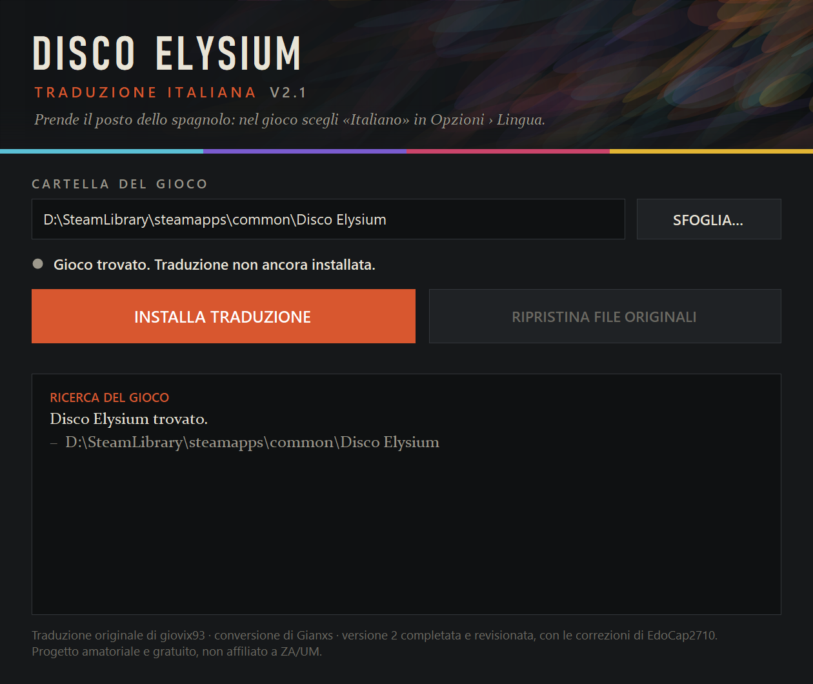
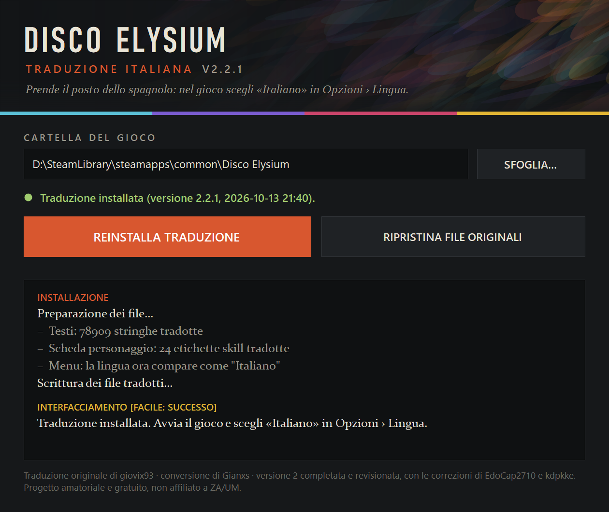

# Disco Elysium – The Final Cut · Traduzione italiana 2.2.1

Traduzione italiana completa di **Disco Elysium – The Final Cut** (Windows), con installatore automatico
che trova il gioco, salva i file originali e permette di ripristinarli in qualsiasi momento.

È il completamento e la revisione della traduzione di **giovix93**, convertita da **Gianxs**
([Nexus Mods #26](https://www.nexusmods.com/discoelysium/mods/26)), con le correzioni della comunità.
Non serve BepInEx.

<p align="center">
  
  
</p>

## Download

Scarica l'archivio `DiscoElysium_Traduzione_ITA_v2.2.1_cmd.zip` dalla pagina
**[Releases](../../releases/latest)**. Su Linux e Steam Deck serve invece
`DiscoElysium_Traduzione_ITA_v2.2.1_file_pronti_Steam.zip` (vedi [Linux e Steam Deck](#linux-e-steam-deck)).

L'archivio non contiene programmi già compilati: `Installa.cmd` compila sul momento il codice C# della
cartella `sorgenti` con il compilatore incluso in Windows e apre la finestra di installazione.
Chiunque può quindi leggere cosa fa il programma prima di avviarlo.

## Installazione

1. Estrai **tutto** l'archivio in una cartella qualsiasi.
2. Chiudi il gioco.
3. Fai doppio clic su **`Installa.cmd`**. Si apre per qualche secondo una finestra nera, poi quella del programma.
4. Il programma trova da solo la cartella del gioco (Steam, GOG, Epic, Game Pass). Se non la trova, premi
   *Sfoglia…* e indica la cartella che contiene `disco.exe` (nella versione Epic si chiama
   `Disco Elysium.exe`: non rinominarlo, dalla 2.0.1 l'installer lo riconosce).
5. Premi **Installa traduzione**.
6. Nel gioco: *Opzioni → Lingua →* **Italiano** (prende il posto di *Español*).

> Se Windows chiede conferma prima di aprire `Installa.cmd`, scegli *Apri* (oppure *Ulteriori informazioni →
> Esegui comunque*). Se non è possibile scrivere nella cartella del gioco, clic destro su `Installa.cmd` →
> *Esegui come amministratore*.

**Dopo un aggiornamento del gioco** o una *verifica integrità dei file* di Steam i testi possono tornare in
spagnolo: basta riavviare `Installa.cmd` e premere di nuovo *Installa traduzione*.

**Da una versione precedente:** avvia `Installa.cmd` della nuova versione e premi *Aggiorna alla versione 2.2.1*.
Non serve rimuovere prima quella vecchia.

**Rimozione:** avvia `Installa.cmd` e premi *Ripristina file originali*. I file del gioco tornano identici a prima.

### Cosa viene modificato

- Quattro file nella cartella del gioco (testi, etichette delle skill, immagini dei pulsanti).
- Gli originali vengono salvati in `_backup_traduzione_ITA`, dentro la cartella del gioco.
- I salvataggi non vengono toccati e il programma non si collega a Internet.

### Uso da riga di comando

```
Installa.cmd /installa [/cartella "percorso del gioco"] [/log file.txt]
Installa.cmd /rimuovi  [/cartella "percorso del gioco"]
```

### Requisiti

Disco Elysium – The Final Cut per Windows, Windows 10 o 11.

### Linux e Steam Deck

Su Linux il gioco gira con Proton e usa gli stessi file della versione Windows di Steam, ma l'installatore
funziona solo su Windows. Per questo c'è l'archivio `..._file_pronti_Steam.zip`: i quattro file già tradotti
dall'installatore sulla versione Steam del gioco, da copiare nella cartella del gioco, più le impronte
SHA-256 per controllare prima, con `sha256sum -c originali.sha256`, che la propria versione sia la stessa.
Le istruzioni sono nel `LEGGIMI.txt` dell'archivio. Per rimuovere la traduzione basta la *verifica integrità
dei file* di Steam.

I file valgono solo per la build di Steam indicata nel `LEGGIMI.txt`: con GOG, Epic o Game Pass, o dopo un
aggiornamento del gioco, possono non corrispondere. L'archivio viene prodotto da `costruisci.ps1`.

## Novità della versione 2.2.1

- Corretto un errore dell'installatore che con la versione **Game Pass** si fermava con "Riferimento a un
  oggetto non impostato su un'istanza di oggetto": salvando `resources.assets` con due oggetti modificati, il
  riallineamento poteva sovrascrivere la tabella degli oggetti. Su Steam, GOG ed Epic i file prodotti non
  cambiano. Grazie all'utente di Nexus che l'ha trovato e corretto.
- La cartella di Game Pass (`XboxGames\Disco Elysium - The Final Cut\Content`) viene trovata da sola.
- Nuovo archivio di file pronti per la versione Steam, per Linux e Steam Deck.

## Novità della versione 2.2

- **Revisione integrale di [kdpkke](https://github.com/kdpkke)**: tutte le 78.909 voci esaminate,
  13.945 correzioni (12.245 nei dialoghi, 1.700 tra interfaccia, descrizioni, oggetti, compiti e pensieri).
  Errori di significato, calchi dall'inglese, registro dei personaggi, pronomi e accordi, terminologia e
  giochi di parole. Le correzioni stanno in `traduzione/revisioni/05_revisione_integrale.tsv`.
- **Terminologia uniformata**: le prove di abilità ora si chiamano *Prova Bianca* e *Prova Rossa*; nomi di
  personaggi, luoghi e oggetti coerenti in tutto il gioco (*Artigiana di dadi speciali*, *Poliziopedia*…).
- Rifinite 280 correzioni della 2.1 (accordi, articoli, scorrevolezza).

In totale ora 17.745 stringhe corrette o nuove su 78.909 (2.191 di interfaccia, 15.554 di dialogo).

## Novità della versione 2.1

- **3.032 battute corrette da [EdoCap2710](https://github.com/EdoCap2710)** (2.962 dialoghi, 70 tra descrizioni,
  oggetti e diario): errori di senso, traduzioni letterali, falsi amici, frasi rimaste in inglese, accordi di
  genere e numero, gergo e coerenza dei termini. Le 27 scene del finale sono state confrontate per intero con
  l'inglese (6.089 battute, varianti comprese). Le correzioni stanno in
  `traduzione/revisioni/04_correzioni_comunita.tsv`.
- Nomi uniformati in tutto il gioco: *Area Commerciale Maledetta* e *pinball*, che richiama il soprannome di Kim.
- Dalla 2.0.1: l'installatore funziona anche con la versione Epic Games.

Nella 2.1: 4.128 stringhe corrette o nuove su 78.909 (546 di interfaccia, 3.582 di dialogo).

## Novità della versione 2.0 rispetto alla 1.1

- **Skill tradotte nella scheda personaggio.** Le etichette non stanno nei bundle di lingua ma in
  `resources.assets` (`CharsheetSkillLabelsSpanish`), che la vecchia patch non toccava.
- La lingua nel menu compare come **Italiano**.
- **Testi mancanti aggiunti**: circa 300 battute dei contenuti introdotti dopo il 2022 (pinball di
  Cornelius Gurdi, giacca "Pissf\*\*\*\*t", body leopardato, nuotatore dei ghiacci…) erano rimaste in spagnolo,
  come una cinquantina di descrizioni dei libri di Dick Mullen; mancavano le voci di menu *Collage* e *Font per dislessia*.
- **Formattazione riparata**: 159 battute con il corsivo non chiuso, 139 con virgolette spaiate,
  7 con le parentesi quadre sbagliate, sequenze `\u00a0` visibili a schermo, un segnaposto `{0}` perso.
- **Revisione dei testi più visibili**: menu e opzioni, descrizioni delle 24 skill, titoli e obiettivi
  dei compiti del diario, nomi di oggetti e pensieri.
- Font e immagini per la **modalità dislessia** e per *Collage* (assenti nella 1.1).
- L'installatore modifica i file dell'utente invece di sostituirli in blocco: funziona anche dopo gli aggiornamenti del gioco.

Nella 2.0: 1.108 stringhe corrette o nuove su 78.909 (480 di interfaccia, 628 di dialogo).

## Limiti noti

- Circa 58.000 battute dei dialoghi sono ancora quelle della 1.1: la revisione della 2.2 le ha esaminate e
  lasciate invariate, ma possono restare errori di senso e di registro.
- Le correzioni della 2.1 e della 2.2 sono state controllate in automatico e a campione, non ancora tutte in gioco.
- In modalità font dislessia i pulsanti illustrati sono in italiano ma con il carattere normale.
- Il font secondario *CoreSansES* non ha la lettera "ò": dove è usato, il gioco la prende da un font di riserva.
- L'installatore funziona solo su Windows; su Linux e Steam Deck ci sono i file pronti per la versione Steam.

Segnalazioni di errori e proposte di correzione sono benvenute nella sezione **Issues**:
indica la frase sbagliata (o la sua chiave, vedi sotto) e la correzione proposta.
Per molte correzioni conviene una **pull request** con un file in `traduzione/revisioni/`, come è stato fatto per la 2.1 e la 2.2.

---

## Per chi vuole modificare la traduzione

### Struttura del repository

| Percorso | Contenuto |
|---|---|
| `traduzione/revisioni/*.tsv` | Correzioni manuali: `General` o `Dialogues`, chiave, testo. Hanno la precedenza su tutto. |
| `traduzione/lotti/*.tsv` | Correzioni numerate riferite alle righe di `da_rivedere.tsv`. |
| `traduzione/etichette_skill.tsv` | Etichette delle skill: id, testo, dimensione font, spaziatura, larghezza, altezza. |
| `traduzione/nomi_lingue.tsv` | Nome della lingua nel menu. |
| `traduzione/italiano_*.tsv` | Testo finale generato (chiave, italiano, inglese). Non modificarlo a mano: viene riscritto. |
| `tools/src/UnityLib.cs` | Lettura/scrittura di bundle UnityFS (LZ4, LZMA) e SerializedFile con TypeTree. |
| `tools/src/PatchCore.cs` | Motore della patch: installazione, backup, ripristino. |
| `tools/src/{Loc,Qa,Build,DeTool}.cs` | Strumenti di analisi, controlli automatici, costruzione dei dati. |
| `tools/patcher/Patcher.cs` | Finestra del programma e ricerca della cartella del gioco. |
| `tools/ps/*.ps1` | Collaudi automatici su una copia dei file del gioco (installa, confronta, ripristina). |
| `pubblicazione/senza_exe/` | `Installa.cmd`, `Installa.ps1` e `LEGGIMI.txt` dell'archivio distribuito. |
| `pubblicazione/file_pronti/` | Modello del `LEGGIMI.txt` dell'archivio di file pronti per la versione Steam. |
| `costruisci.ps1` | Ricostruisce tutto: strumenti, testo finale, controlli, cartella `dati`, archivi. |

### Aggiungere una correzione

1. Cerca la frase in `traduzione/italiano_Dialogues.tsv` (o `italiano_General.tsv`) e copiane la chiave.
2. Aggiungi una riga a un file di `traduzione/revisioni/` con `Dialogues` (o `General`), la chiave e il
   nuovo testo, separati da tabulazioni (`\n` = a capo).
3. Ricostruisci.

### Costruzione

Serve solo il compilatore C# incluso in Windows (`csc.exe` del .NET Framework 4.x): non si installa nulla.

Prerequisiti:

- il gioco installato, con i file **originali** (se la traduzione è già installata lo script usa da solo la
  copia in `_backup_traduzione_ITA`);
- la patch 1.1 originale estratta in `patch_originale_v1.1/` (da
  [Nexus Mods #26](https://www.nexusmods.com/discoelysium/mods/26)), in modo che esistano
  `patch_originale_v1.1/disco_Data/StreamingAssets/AssetBundles/Windows/lockits/spanish` e `.../images/spanish`.
  È la fonte del testo di partenza e delle immagini dei pulsanti.

```powershell
powershell -ExecutionPolicy Bypass -File costruisci.ps1 -GameDir "C:\percorso\Disco Elysium" -Versione 2.2.1
```

Lo script produce in `pubblicazione/` l'archivio con l'exe, quello senza exe
(`..._senza_exe.zip`, lo stesso pubblicato nelle Release come `..._cmd.zip`) e quello di file pronti per la
versione Steam (`..._file_pronti_Steam.zip`), tradotti dall'installatore su una copia degli originali del gioco
indicato con `-GameDir`.
I file intermedi finiscono in `work/` e `build/`, esclusi dal repository.

## Licenza

Il codice (installatore, strumenti e script) è distribuito con licenza [MIT](LICENSE).

I testi della traduzione e le immagini derivano dalla mod originale e dal gioco: non rientrano nella
licenza MIT e restano soggetti ai permessi indicati qui sotto.

## Crediti

- Traduzione italiana originale: **giovix93**
- Conversione senza BepInEx e pubblicazione originale: **Gianxs** –
  [Nexus Mods #26](https://www.nexusmods.com/discoelysium/mods/26)
- Versione 2.0: completamento, correzioni, traduzione delle skill e programma di installazione.
- Versione 2.1: revisione di 3.032 battute di **[EdoCap2710](https://github.com/EdoCap2710)**,
  con il confronto integrale del finale.
- Versione 2.2: revisione integrale di **[kdpkke](https://github.com/kdpkke)**, 13.945 correzioni.

I permessi della pagina originale consentono di modificare i file e pubblicare miglioramenti,
e di riusarne le risorse purché non in mod a pagamento.

Parte dei testi rivisti (comprese le correzioni della 2.1 e della 2.2) e il programma di installazione sono
stati realizzati con l'aiuto di strumenti di AI.

Mod amatoriale e gratuita, non affiliata a ZA/UM. *Disco Elysium* è un marchio dei rispettivi proprietari;
per usare la traduzione serve una copia legittima del gioco.
